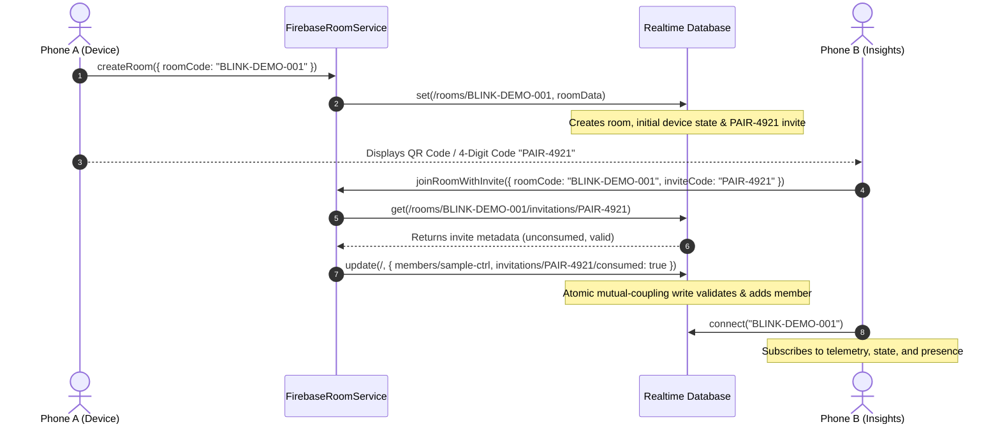
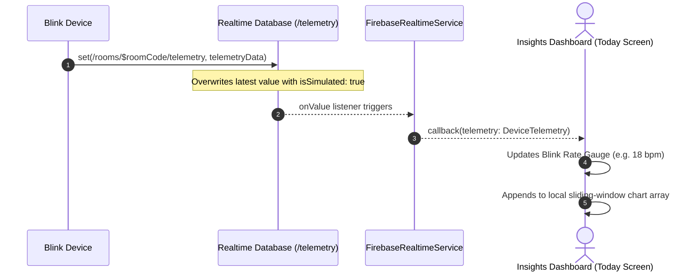
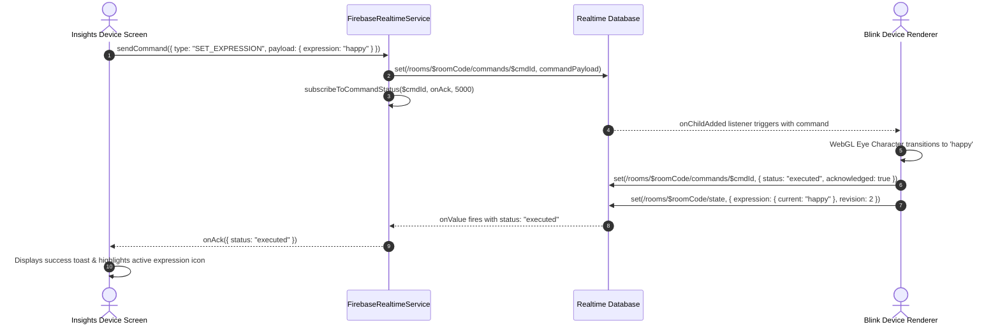
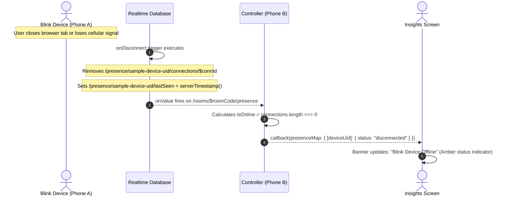

# 07 — Complete End-to-End Data Flows

This document details the exact sequence of service invocations, RTDB paths, event payloads, failure modes, and UI responsibilities across all 8 operational workflows in Blink Web.

---

## WORKFLOW 1: Room Creation & Companion Pairing



- **Entry Point**: Insights Pairing Screen / Invite Code Input (`joinRoomWithInvite`).
- **RTDB Paths**:
  - Read: `/rooms/$roomCode/invitations/$inviteCode`
  - Atomic Write: `/rooms/$roomCode/members/$uid` AND `/rooms/$roomCode/invitations/$inviteCode/consumed`
- **Failure Conditions**:
  - *Invitation Expired*: Throws `'Invitation has expired'`. UI displays: "Invite code timed out. Please request a new code from the Blink eye device."
  - *Already Consumed*: Throws `'Invitation has already been consumed'`.
  - *Invalid Code*: Throws `'Invitation does not exist'`.
- **UI Responsibilities**: Present numeric 4-digit code entry; show loading indicator during atomic transaction; transition to dashboard on success.

---

## WORKFLOW 2: Live Telemetry Streaming & Dashboard Rendering



- **Entry Point**: `realtimeService.subscribeToTelemetry(callback)`.
- **RTDB Path**: `/rooms/$roomCode/telemetry` (Transient latest-value).
- **Event Payload**: `DeviceTelemetry` (`currentBlinkRatePerMinute`, `averageBlinkRatePerMinute`, `eyeFatigueScore`, `isSimulated: true`).
- **Failure Conditions**: Temporary network socket disconnect -> RTDB pauses stream -> resumes automatically upon reconnection.
- **UI Responsibilities**: Display live gauge; smooth transitions; badge simulated indicator; push sample into local chart history.

---

## WORKFLOW 3: Expression Command Dispatch & Execution Loopback



- **Entry Point**: `realtimeService.sendCommand(command, { timeoutMs })`.
- **RTDB Paths**:
  - Dispatch: `/rooms/$roomCode/commands/$commandId`
  - Device Ack: `/rooms/$roomCode/commands/$commandId`
  - State Sync: `/rooms/$roomCode/state`
- **Failure Conditions**:
  - *Device Offline / No Ack*: `subscribeToCommandStatus` times out after `timeoutMs` -> fires synthetic `'timed_out'` acknowledgment. UI displays: "Device did not respond in time."
  - *Room Closed*: Security rule rejects write with `Permission denied`.

---

## WORKFLOW 4: Monitoring Session Lifecycle

```mermaid
sequenceDiagram
    autonumber
    actor Ctrl as Insights Focus Screen
    participant RTS as FirebaseRealtimeService
    participant RTDB as Realtime Database
    actor Dev as Blink Device Simulator

    Ctrl->>RTS: sendCommand({ type: "START_MONITORING" })
    RTDB-->>Dev: Receives START_MONITORING command
    Dev->>Dev: Simulator begins counting blinks & elapsed time
    Dev->>RTDB: update(/rooms/$roomCode/state/monitoring, { mode: "active", sessionStartedAt: now })
    Dev->>RTDB: acknowledgeCommand(cmdId, "executed")
    
    RTDB-->>RTS: State subscription triggers
    RTS-->>Ctrl: Updates UI with mode: "active"
    Ctrl->>Ctrl: Focus timer begins ticking; live duration displayed
```

- **Entry Point**: `realtimeService.sendCommand({ id: uuid(), type: 'START_MONITORING', ... })`.
- **State Change**: `monitoring.mode` transitions `'idle'` -> `'active'`.
- **UI Responsibilities**: Change Start button to Pause/Stop; display active timer and pulse indicator.

---

## WORKFLOW 5: Low-Blink Nudge Alert & Acknowledgment

- **Condition**: Device detects sustained low blink rate (< 12 bpm for > 20s).
- **Device Action**:
  1. Triggers visual nudge animation on character.
  2. Updates `/rooms/$roomCode/state/expression` with `current: 'nudging'`.
- **Insights Action**:
  1. State subscription receives `nudging` expression.
  2. Today screen displays banner: "Eye fatigue detected: Character is prompting a 20-second break."
  3. User taps "Acknowledge Nudge" -> Insights dispatches `SET_EXPRESSION` (`expression: 'happy'`) to return character to calm state.

---

## WORKFLOW 6: Physical Device Disconnect Detection



- **Mechanism**: Firebase server-side `onDisconnect` handles unexpected socket severance without client cooperation.
- **UI Responsibilities**: Disable expression controls; show offline banner; preserve last telemetry readings.

---

## WORKFLOW 7: Connection Recovery & Re-synchronization

- **Condition**: Phone A re-opens browser tab or cellular data recovers.
- **Sequence**:
  1. Device initiates reconnect -> Firebase assigns new socket connection ID.
  2. Re-registers connection node under `/rooms/$roomCode/presence/$uid/connections/conn_<newId>`.
  3. Updates presence status to `'connected'`.
  4. Realtime Database triggers `onValue` presence listener on Insights.
  5. Insights automatically detects `status === 'connected'`.
  6. Subscriptions to telemetry and state continue receiving data without page reload.

---

## WORKFLOW 8: Room Expiry & Teardown

- **Condition**: Room exceeds 24-hour expiration (`expiresAt <= Date.now()`) or owner closes room (`status: 'closed'`).
- **Security Rule Enforcement**:
  - `root.child('rooms').child($roomId).child('status').val() !== 'closed'` evaluates to `false`.
  - `root.child('rooms').child($roomId).child('expiresAt').val() > now` evaluates to `false`.
- **Runtime Impact**:
  - All subsequent command dispatches and state writes fail with `Permission denied`.
- **UI Responsibilities**:
  - Insights detects `room.status === 'closed'` or `room.expiresAt <= Date.now()`.
  - Displays modal: "This pairing session has expired. Please pair with your Blink device again."
  - Calls `realtimeService.disconnect()` and routes user back to `/insights/pair`.
